<div align="center">

<picture>
  <source media="(prefers-color-scheme: dark)" srcset="docs/banner-escuro.png" />
  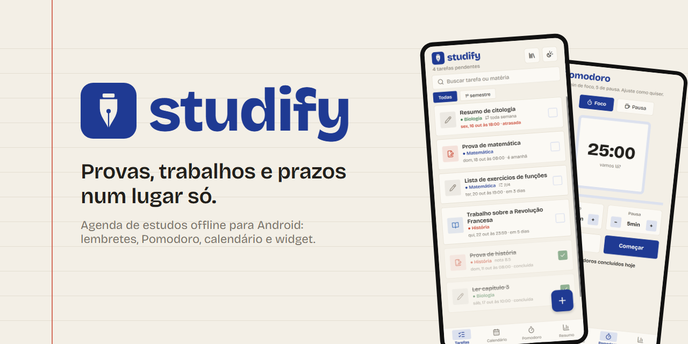
</picture>

<br />


**[Em ação](#em-ação)** · **[Funcionalidades](#funcionalidades)** · **[Telas](#telas)** · **[Como rodar](#como-rodar)** · **[Arquitetura](#arquitetura)** · **[Roadmap](#roadmap)**

</div>

---

## O que é o Studify

O **Studify** é uma agenda de estudos para Android que coloca provas, trabalhos e tarefas num lugar só. Você anota o que tem pra fazer, separa por matéria, recebe o lembrete na hora certa e acompanha o próprio ritmo de estudo, tudo sem depender de internet.

Ele nasceu pra substituir o bloco de notas do celular, onde prova, prazo e lista de exercício ficavam misturados e esquecidos. A ideia é simples: **abrir o app e saber, em dois segundos, o que vence primeiro.**

<table>
<tr>
<td width="33%" valign="top">

**Organiza**<br />
Tarefas por tipo, matéria e módulo, com etapas, fotos do caderno e repetição automática.

</td>
<td width="33%" valign="top">

**Lembra**<br />
Notificação antes do prazo, widget na tela inicial e calendário com o mês inteiro.

</td>
<td width="33%" valign="top">

**Acompanha**<br />
Pomodoro, sequência de dias estudando, média das provas e resumo do mês.

</td>
</tr>
</table>

---

## Em ação

<div align="center">

<table>
<tr>
<td align="center" width="25%">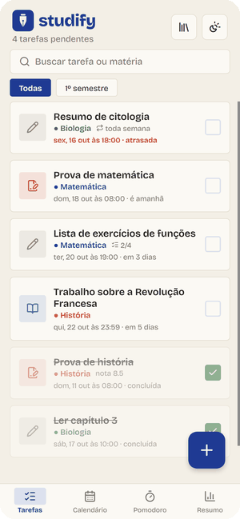<br /><sub><b>Tour pelas abas</b><br />tarefas, calendário, Pomodoro e resumo</sub></td>
<td align="center" width="25%"><br /><sub><b>Concluir tarefa</b><br />um toque no quadrado, com confete</sub></td>
<td align="center" width="25%"><br /><sub><b>Nova tarefa</b><br />tipo, matéria, prazo e lembrete</sub></td>
<td align="center" width="25%"><br /><sub><b>Claro e escuro</b><br />automático ou no botão do topo</sub></td>
</tr>
</table>

</div>

---

## Funcionalidades

### Organização

| | |
|---|---|
| **Tarefas com tipo** | Prova, trabalho ou tarefa, cada um com ícone e cor próprios |
| **Módulos e matérias** | Matérias agrupadas por módulo (semestre, bimestre, curso), cada uma com sua cor |
| **Busca e filtro** | Por texto, por módulo ou por matéria |
| **Etapas** | Checklist dentro da tarefa, com o progresso visível no card (ex.: 2/4) |
| **Repetição** | Semanal, mensal ou a cada N dias. Ao concluir, a próxima ocorrência é criada sozinha |
| **Fotos** | Foto do caderno ou da lousa direto na tarefa, pela câmera ou galeria |

### Estudo

| | |
|---|---|
| **Calendário** | Mês inteiro com marcadores na cor da matéria. Toque no dia para ver as tarefas |
| **Pomodoro** | Foco e pausa ajustáveis. O cronômetro continua rodando em qualquer aba, em segundo plano e com o app fechado |
| **Notas das provas** | Lance a nota e veja a média por matéria |
| **Resumo** | Concluídas no mês, pendentes, atrasadas e sequência de dias estudando |

### No dia a dia

| | |
|---|---|
| **Lembretes** | Na hora, 1 h, 1 dia ou 3 dias antes. Funcionam com o app fechado |
| **Widget** | As próximas tarefas na tela inicial do Android |
| **Tema claro e escuro** | Segue o sistema ou fica fixo, à sua escolha |
| **Backup** | Exporta e importa tudo num arquivo |
| **Sincronização** | Opcional: celular e tablet com os mesmos dados |
| **100% offline** | A internet só é usada para sincronizar, se você ligar |

---

## Telas

<div align="center">

| Tarefas | Calendário | Pomodoro | Resumo |
|:---:|:---:|:---:|:---:|
| 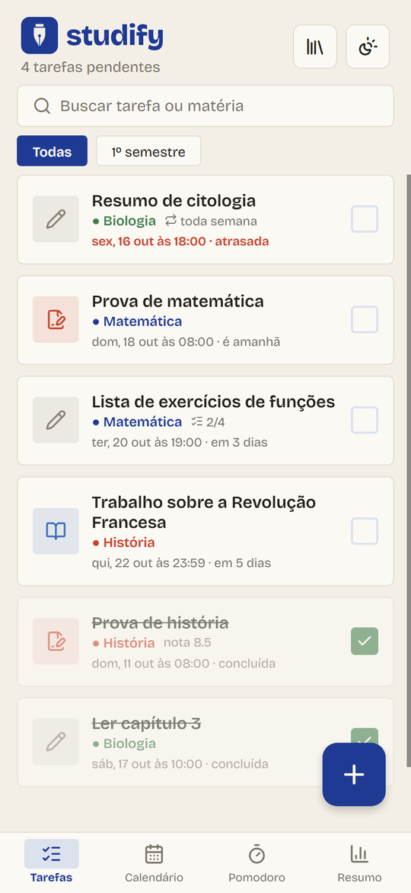 | 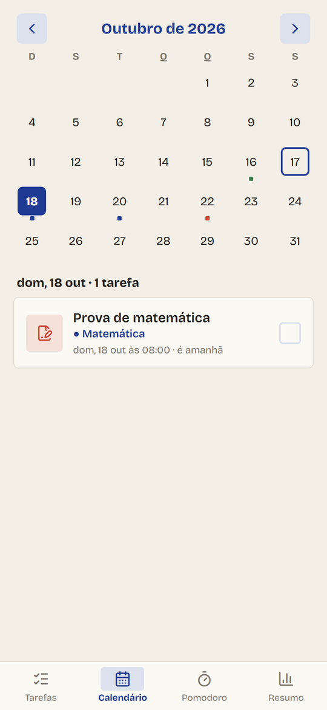 | 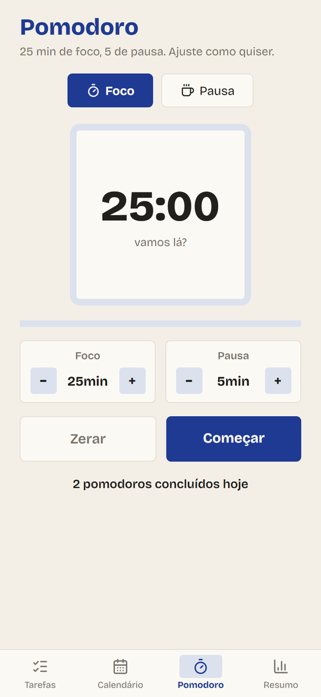 | 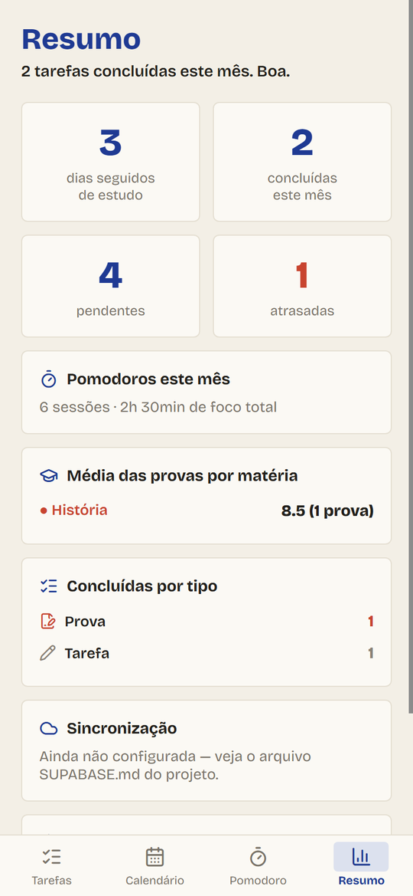 |
| 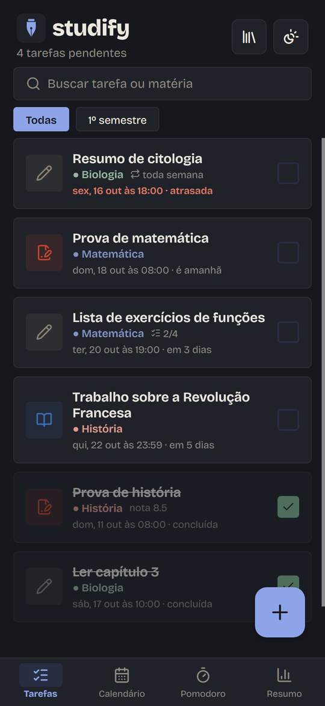 | 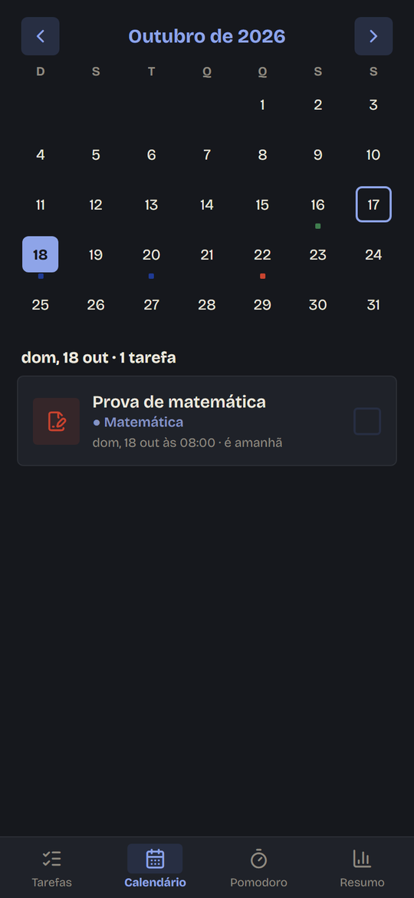 | 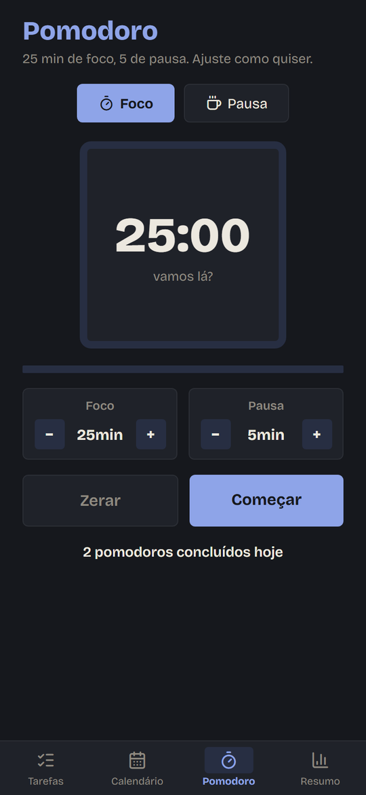 | 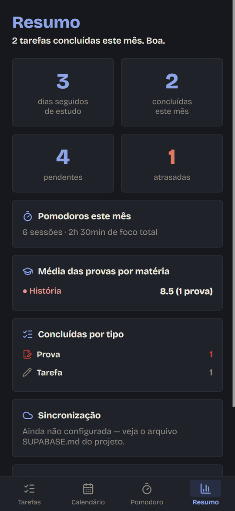 |

| Nova tarefa | Módulos e matérias |
|:---:|:---:|
| 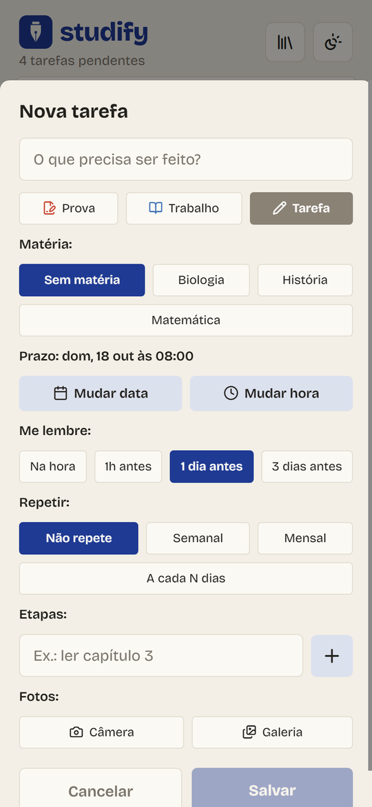 | 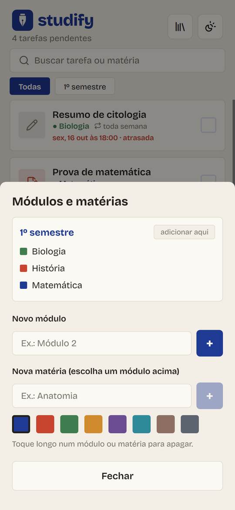 |

</div>

---

## Identidade visual

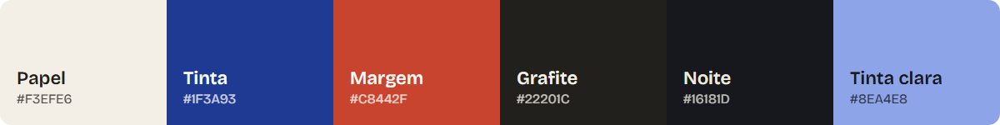

O visual parte do material escolar de verdade: **papel de caderno**, **tinta de caneta azul** e o **vermelho da margem**, usado só para provas e atrasos.

- **Logo:** a ponta de uma caneta-tinteiro, em [`docs/logo/`](docs/logo) nas versões clara e escura
- **Fonte:** [Bricolage Grotesque](https://fonts.google.com/specimen/Bricolage+Grotesque) em todo o app, inclusive no widget
- **Ícones:** [Lucide](https://lucide.dev), de traço fino e uma cor só. O app não usa emoji
- **Formas:** cantos retos (raio de 4 a 8 px), sem cara de app genérico

---

## Tecnologias

| Camada | Escolha | Por quê |
|---|---|---|
| App | **React Native 0.86** + **Expo SDK 57** | Um código só para celular e tablet |
| Dados | **expo-sqlite** | Banco local: o app funciona sem internet |
| Lembretes | **expo-notifications** | Notificações locais agendadas |
| Nuvem | **Supabase** (Postgres + Auth) | Sincronização opcional entre aparelhos |
| Widget | **Java + RemoteViews** via config plugin | Widget nativo, sem depender do React Native |
| Interface | Componentes próprios, **Lucide** e **Bricolage Grotesque** | Sem biblioteca de UI pronta |

---

## Arquitetura

Offline-first: o **SQLite é a fonte da verdade** no aparelho. O Supabase é só uma cópia na nuvem para manter os aparelhos iguais, e em caso de conflito vale a alteração mais recente.

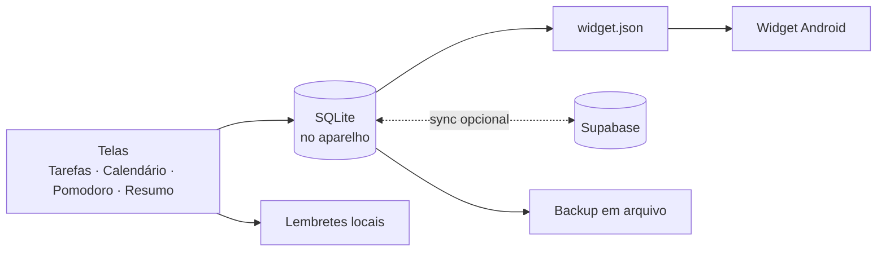

```
.
├── App.js                     # entrada: fontes, tema, abas e sincronização inicial
├── src/
│   ├── theme.js               # paletas clara/escura, fontes, tipos e cores de matéria
│   ├── theme-context.js       # provedor de tema com alternância salva
│   ├── db/database.js         # SQLite, migrações, estatísticas e backup
│   ├── notifications/         # lembretes locais
│   ├── pomodoro/              # cronômetro global (roda em qualquer aba)
│   ├── attachments/           # fotos das tarefas
│   ├── widget/                # grava o resumo lido pelo widget
│   ├── sync/                  # cliente Supabase e motor de sincronização
│   ├── utils/                 # datas em pt-BR e backup em arquivo
│   ├── components/            # cards, formulário, abas, gerenciador de matérias
│   └── screens/               # Tarefas, Calendário, Pomodoro e Resumo
├── plugins/task-widget/       # widget Android (Java, layout, fonte), instalado no prebuild
├── supabase/schema.sql        # tabelas e segurança (RLS) da nuvem
└── docs/                      # logo, banner, prints e GIFs deste README
```

---

## Como rodar

**Desenvolvimento**

```bash
npm install
npx expo start
```

**Gerar o APK** (build local com o Android SDK)

```bash
npx expo prebuild --platform android --clean
cd android && ./gradlew assembleRelease
```

O APK sai em `android/app/build/outputs/apk/release/app-release.apk`. É só mandar para o celular, tocar no arquivo e permitir a instalação.

<details>
<summary><b>Atualizando um APK já instalado</b></summary>

<br />

Instale o novo `.apk` por cima, sem desinstalar: tarefas, fotos e notas continuam lá. Para o Android aceitar a atualização:

- a cada versão, aumente `android.versionCode` e `version` no `app.json`
- o identificador do pacote (`android.package` no `app.json`) e a chave de assinatura precisam continuar os mesmos

Trocar o identificador do pacote faz o Android tratar o app como outro: o APK não instala por cima e os dados ficam para trás.

Se aparecer "app não instalado", quase sempre o `versionCode` não subiu ou o APK anterior foi assinado com outra chave.

</details>

> **Atenção:** os lembretes não funcionam dentro do Expo Go (limitação do Android desde o SDK 53). No APK instalado eles funcionam normalmente.

---

## Sincronização entre aparelhos

Opcional e desligada por padrão. Para deixar celular e tablet com os mesmos dados, siga o passo a passo em **[SUPABASE.md](SUPABASE.md)**. Leva uns 10 minutos e usa o plano gratuito do Supabase.

---

## Roadmap

**Entregue na v1.1**

- [x] Repetição mensal e por intervalo ("a cada 15 dias")
- [x] Fotos nas tarefas
- [x] Widget na tela inicial do Android
- [x] Cronômetro do Pomodoro rodando em qualquer aba, em segundo plano e com o app fechado
- [x] Identidade nova: nome, logo, paleta, fonte e ícones

**Próximas versões**

- [ ] Login simples com a conta Google, sem configuração manual
- [ ] Fotos no backup e na sincronização (hoje ficam só no aparelho)
- [ ] Widget que atualiza no instante em que uma tarefa muda
- [ ] Cronômetro com notificação fixa mostrando o tempo restante
- [ ] Anexar PDFs e outros arquivos, além de fotos

---

<div align="center">

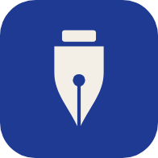

**Studify** · feito para quem estuda · [licença MIT](LICENSE)

</div>
